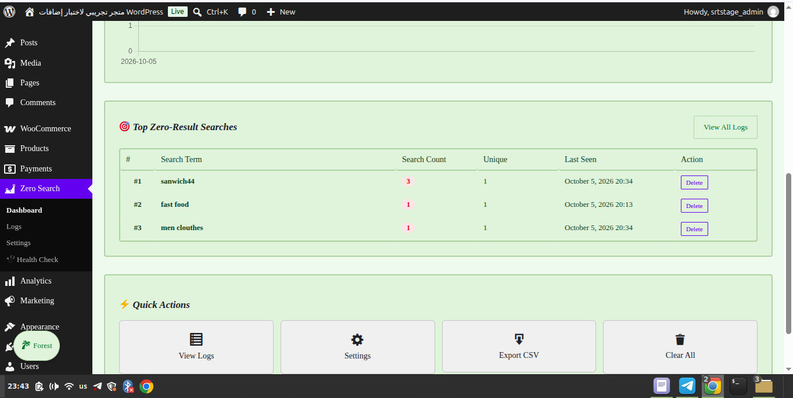
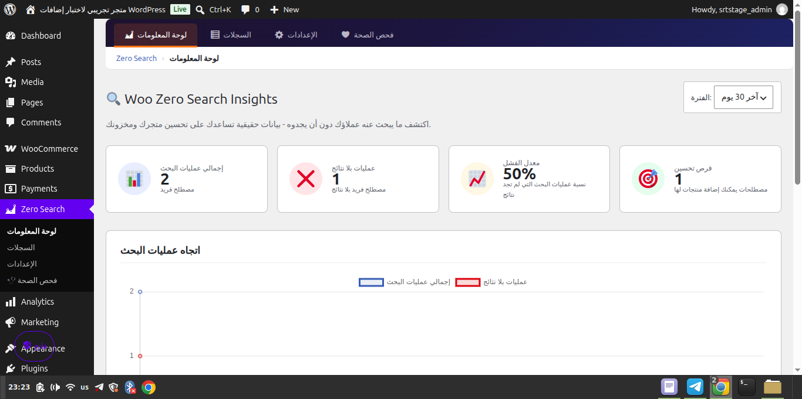
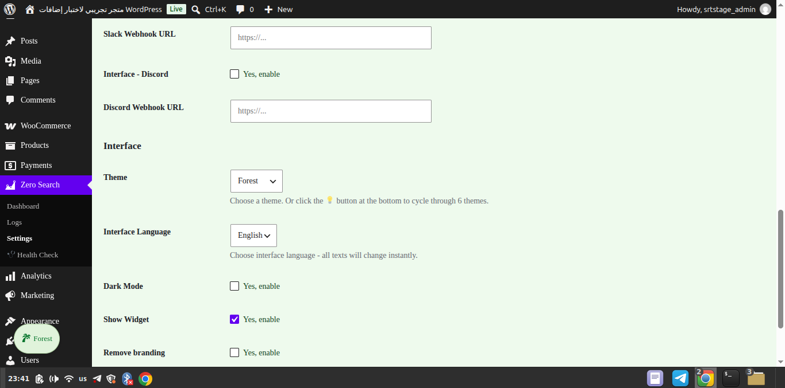

# Woo Zero Search Insights

Track every WooCommerce search that returns **zero results** — and turn missed searches into product ideas, SEO keywords, and real demand data.

**تتبّع كل عملية بحث في ووكومرس تنتهي بصفر نتائج — وحوّلها إلى أفكار منتجات وكلمات مفتاحية وبيانات طلب حقيقية.**

- **Requires / المتطلبات:** WordPress 5.6+ · WooCommerce 5.0+ · PHP 7.4+ (tested up to WP 6.8 / WC 10.1)
- **License / الترخيص:** GPLv2 or later
- **Author / المطور:** az-soft4media

---

## Download v1.0.1 — تحميل الإصدار

| File / الملف | Description / الوصف |
|------|-------------|
| [woo-zero-search-insights-1.0.1.zip](release/v1.0.1/woo-zero-search-insights-1.0.1.zip) | Installable plugin — ملف الإضافة الجاهز للتثبيت المباشر (Plugins → Add New → Upload Plugin) |
| [woo-zero-search-insights-v1.0.1-package.zip](release/v1.0.1/woo-zero-search-insights-v1.0.1-package.zip) | Full sales package — الحزمة الكاملة: الإضافة + 6 لقطات شاشة + أدلة PDF ثنائية اللغة + مواد التسويق |
| [GitHub Releases](../../releases/tag/v1.0.1) | All release assets in one page — كل ملفات الإصدار في صفحة واحدة |

**Docs & guides / المستندات والأدلة:** [release/v1.0.1/](release/v1.0.1) · [Installation & user guide AR/EN (PDF)](release/v1.0.1/docs/installation-user-guide-AR-EN.pdf) · [CHANGELOG](release/v1.0.1/docs/CHANGELOG-1.0.1.txt) · [Start here / ابدأ من هنا](release/v1.0.1/README-START-HERE.txt)

---

## What it does — ماذا يفعل

When a customer searches your store and gets **no results**, that is not a dead end — it is a direct signal of unmet demand. This plugin records that moment silently, then shows you exactly what people wanted and could not find.

عندما يبحث أحد العملاء في متجرك فلا يجد شيئاً، فهذه ليست نهاية الطريق — بل إشارة مباشرة على طلب غير مُلبّى. تسجّل هذه الإضافة تلك اللحظة بصمت، ثم تعرض لك بدقة ما أراده الناس ولم يجدوه.

## Key features — المزايا

- **Automatic tracking / تتبّع تلقائي** — captures every failed WooCommerce search (standard + AJAX live search + REST Store API) with zero configuration.
- **Professional dashboard / لوحة تحكم احترافية** — stat cards, daily trend chart (Chart.js bundled locally, no CDN), ranked table of top zero-result terms.
- **Full search log / سجل بحث كامل** — every query recorded with anonymized IP, device type, timestamp, and request type.
- **CSV export / تصدير CSV** — full or filtered export with UTF-8 BOM, Excel-ready and Arabic-safe.
- **Slack & Discord webhooks / إشعارات فورية** — real-time alerts on new zero-result terms with smart throttling (one alert per term per hour).
- **Privacy first / الخصوصية أولاً** — IP anonymization and full data cleanup on uninstall (incl. Multisite).
- **Arabic & RTL ready / جاهز للعربية** — multibyte-safe matching, RTL dashboard, translatable (`.pot` included).
- **White-label / علامة بيضاء** — optional branding removal for agencies.

## What's new in 1.0.1 — الجديد في هذا الإصدار

19 issues fixed: 5 critical, 6 medium, 8 quality improvements. تم إصلاح 19 مشكلة: 5 حرجة و6 متوسطة و8 تحسينات.

- **Critical / حرجة:** Slack/Discord notifications never fired (hook not triggered) — now fully working · fatal error when WooCommerce inactive · wrong cron cleanup on uninstall · duplicated AJAX handlers · missing webhook i18n strings.
- **Medium / متوسطة:** MySQL compatibility for the index creation · hardcoded Arabic strings in CSV/AJAX replaced with translations · missing `%s` placeholders · wrong footer prefix · `results_count` not updated on repeated searches · notification throttling per term per hour.
- **Improvements / تحسينات:** Chart.js bundled locally · safer debug logging (opt-in, non-autoload) · multibyte-safe Arabic matching · premium UI option wired · updated readme & `.pot`.

Full details: [CHANGELOG-1.0.1.txt](release/v1.0.1/docs/CHANGELOG-1.0.1.txt)

## Installation — التثبيت

1. Download `woo-zero-search-insights-1.0.1.zip` from the table above.
   حمّل الملف من الجدول أعلاه.
2. WordPress admin → **Plugins → Add New → Upload Plugin** → choose the zip → **Install** → **Activate**.
   من لوحة التحكم: إضافات ← أضف جديد ← رفع إضافة ← اختر الملف ← تثبيت ← تفعيل.
3. Open **Tools → Zero Search Insights** to view the dashboard.
   افتح: أدوات ← Zero Search Insights لعرض اللوحة.

## Screenshots — لقطات الشاشة

| Dashboard / لوحة التحكم | Top terms / أكثر المصطلحات |
|---|---|
|  |  |

| Arabic RTL / العربية | Integrations / التكاملات |
|---|---|
|  |  |

All 6 screenshots: [release/v1.0.1/screenshots/](release/v1.0.1/screenshots)
