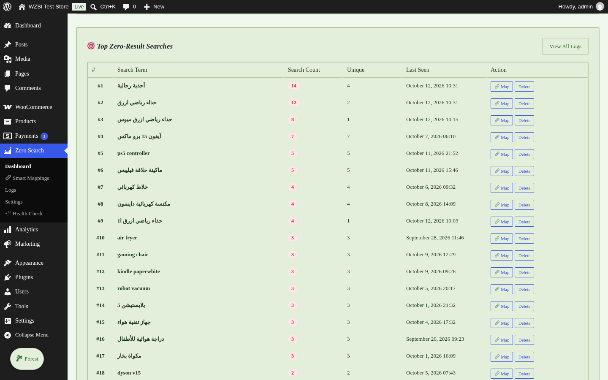
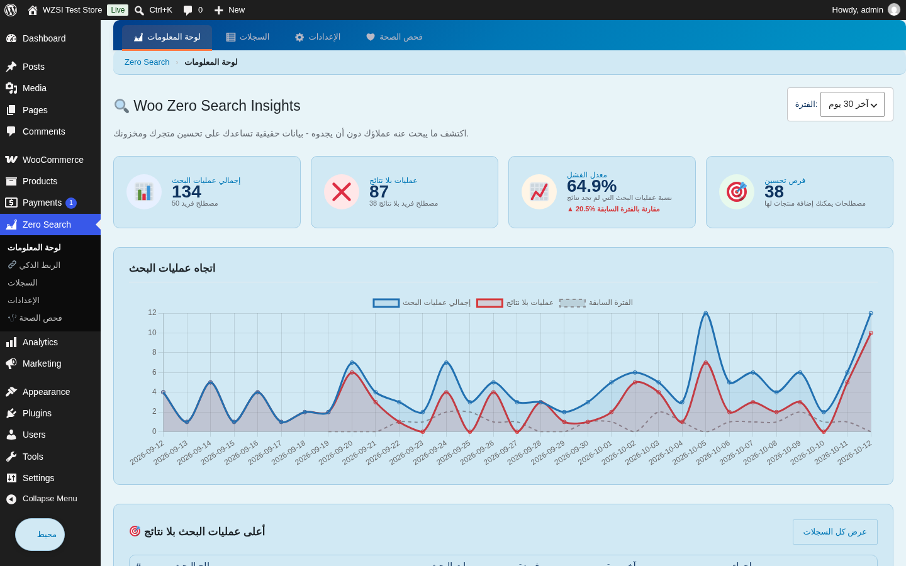
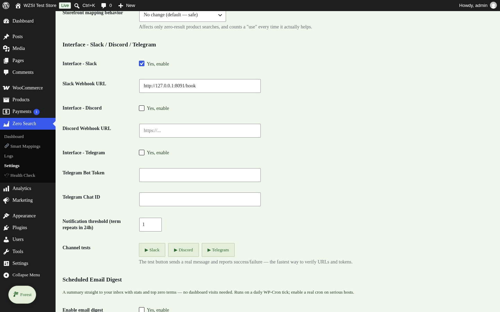
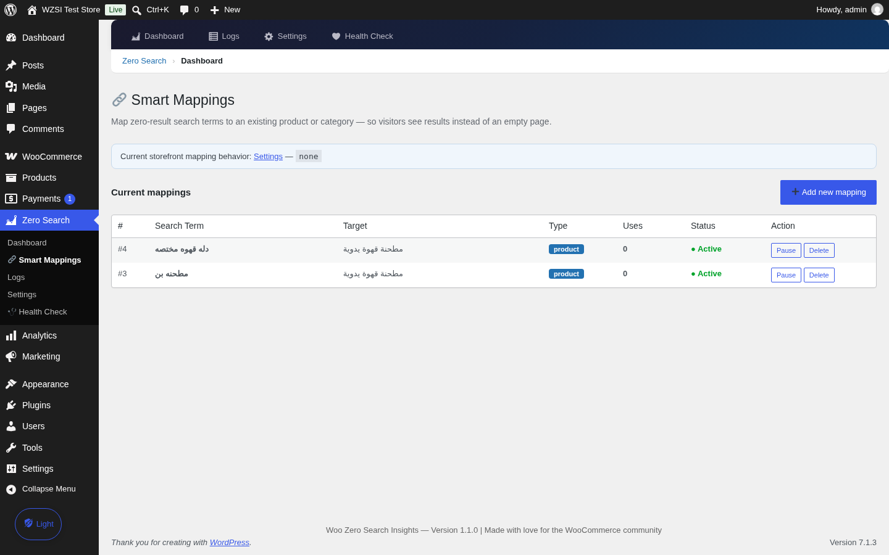
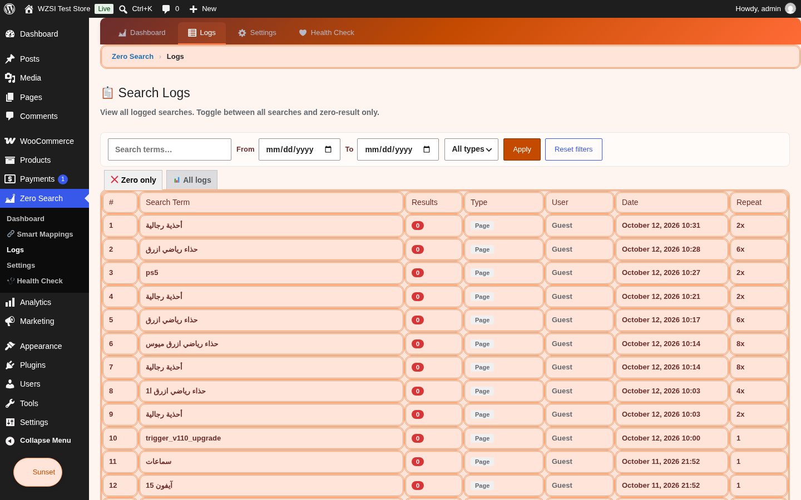

# Woo Zero Search Insights

Track every WooCommerce search that returns **zero results** — and turn missed searches into product ideas, SEO keywords, and real demand data. v1.1.0 goes further: **map any zero term to an existing product** so visitors find results instead of an empty page.

**تتبّع كل عملية بحث في ووكومرس تنتهي بصفر نتائج — وحوّلها إلى أفكار منتجات وكلمات مفتاحية وبيانات طلب حقيقية. الإصدار 1.1.0 يذهب أبعد: اربط أي مصطلح صفري بمنتج موجود فيجد الزائر نتيجة بدل صفحة فارغة.**

- **Requires / المتطلبات:** WordPress 5.6+ · WooCommerce 5.0+ · PHP 7.4+ (tested up to WP 7.1 / WC 11.2)
- **License / الترخيص:** GPLv2 or later
- **Author / المطور:** az-soft4media

---

## Download v1.1.0 — تحميل الإصدار

| File / الملف | Description / الوصف |
|------|-------------|
| [woo-zero-search-insights-1.1.0.zip](release/v1.1.0/woo-zero-search-insights-1.1.0.zip) | Installable plugin — ملف الإضافة الجاهز للتثبيت المباشر (Plugins → Add New → Upload Plugin) |
| [woo-zero-search-insights-v1.1.0-package.zip](release/v1.1.0/woo-zero-search-insights-v1.1.0-package.zip) | Full sales package — الحزمة الكاملة: الإضافة + 7 لقطات شاشة + أدلة PDF ثنائية اللغة + مواد التسويق |
| [GitHub Releases](../../releases/tag/v1.1.0) | All release assets in one page — كل ملفات الإصدار في صفحة واحدة |
| [🗺️ ROADMAP.md](ROADMAP.md) | Next version plan (v1.2.0) — what's coming & how — خطة النسخة القادمة: ماذا سنضيف وكيف ستنفّذ |

**Docs & guides / المستندات والأدلة:** [release/v1.1.0/](release/v1.1.0) · [Installation & user guide AR/EN (PDF)](release/v1.1.0/docs/installation-user-guide-AR-EN.pdf) · [CHANGELOG v1.1.0](release/v1.1.0/docs/CHANGELOG-1.1.0.txt) · [Start here / ابدأ من هنا](release/v1.1.0/README-START-HERE.txt) · [v1.0.1 (previous / السابق)](release/v1.0.1)

---

## What it does — ماذا يفعل

When a customer searches your store and gets **no results**, that is not a dead end — it is a direct signal of unmet demand. This plugin records that moment silently, then shows you exactly what people wanted and could not find.

عندما يبحث أحد العملاء في متجرك فلا يجد شيئاً، فهذه ليست نهاية الطريق — بل إشارة مباشرة على طلب غير مُلبّى. تسجّل هذه الإضافة تلك اللحظة بصمت، ثم تعرض لك بدقة ما أراده الناس ولم يجدوه.

## Key features — المزايا

- **Automatic tracking / تتبّع تلقائي** — captures every failed WooCommerce search (standard + AJAX live search + REST Store API) with zero configuration.
- **Professional dashboard / لوحة تحكم احترافية** — stat cards, daily trend chart (Chart.js bundled locally, no CDN), ranked table of top zero-result terms.
- **Full search log / سجل بحث كامل** — every query recorded with anonymized IP, device type, timestamp, and request type.
- **CSV export / تصدير CSV** — full or filtered export with UTF-8 BOM, Excel-ready and Arabic-safe.
- **Slack & Discord webhooks / إشعارات فورية** — real-time alerts on new zero-result terms with smart throttling (one alert per term per hour).
- **Privacy first / الخصوصية أولاً** — IP anonymization and full data cleanup on uninstall (incl. Multisite).
- **Arabic & RTL ready / جاهز للعربية** — multibyte-safe matching, RTL dashboard, translatable (`.pot` included).
- **Smart Mappings / الربط الذكي** — map a zero-result term to a product/category/URL with three storefront behaviors and a usage counter.
- **Email digest / تقرير بريدي دوري** — daily/weekly HTML summary (auto-RTL) with a test-send button.
- **Telegram + threshold / تلغرام وعتبة** — new channel beside Slack/Discord, per-channel test buttons, alert only after N repeats in 24h.
- **Bot filtering + Arabic normalization / فلترة روبوتات وتطبيع عربي** — crawlers excluded; hamza/taa-marbuta/diacritics folded automatically.
- **White-label / علامة بيضاء** — optional branding removal for agencies.

## What's new in 1.1.0 — الجديد في هذا الإصدار

The release that closes the loop: from *reporting* gaps to *fixing* them. إصدار إغلاق الحلقة: من اكتشاف الفجوات إلى سدّها.

- **Smart Mappings / الربط الذكي** — map any zero-result term to a product/category/URL, with three storefront behaviors (none / add-to-results / redirect) and a usage counter. اربط أي مصطلح صفري بمنتج أو تصنيف أو رابط مع ثلاثة سلوكيات وعدّاد استفادات.
- **Email digest / تقرير بريدي** — daily or weekly HTML summary (auto-RTL) with stats, top 10 zero terms and the previous-period delta + test-send button. تقرير يومي/أسبوعي مع زر إرسال تجريبي.
- **Telegram + threshold / تلغرام وعتبة** — new channel, per-channel test buttons, alerts only after a term repeats N times in 24h. قناة جديدة وعتبة ذكية وأزرار اختبار.
- **Bot filtering + Arabic normalization / فلترة روبوتات وتطبيع عربي** — crawlers no longer inflate stats; “أحذية / احذيه / أحذيةَ” group as one opportunity with safe batched migration. عناكب الزحف لا تُحصى، والمصطلحات العربية المتشابهة تتجمع تلقائياً.
- **Log filters + chart comparison / فلاتر ومقارنة** — search & date & type filters on logs; dashed previous-period line in the chart with a colored delta badge.
- **WP-CLI & REST + settings backup / أدوات الوكيلات** — `wp wzsi stats|top|logs|clear|prune`, read-only `wzsi/v1` endpoints (no PII), JSON settings export/import.
- **Performance / أداء** — version-keyed 5-min dashboard cache with instant invalidation. كاش 5 دقائق بمفتاح إصدار مع إبطال فوري.

Full details: [CHANGELOG-1.1.0.txt](release/v1.1.0/docs/CHANGELOG-1.1.0.txt)

<b>What was in 1.0.1 — ماذا كان في 1.0.1</b>

19 issues fixed: 5 critical, 6 medium, 8 quality improvements — Slack/Discord webhooks fired, local Chart.js, MySQL-safe indexing, multisite-safe uninstall. Full details: [CHANGELOG-1.0.1.txt](release/v1.0.1/docs/CHANGELOG-1.0.1.txt)

## Installation — التثبيت

1. Download `woo-zero-search-insights-1.1.0.zip` from the table above.
   حمّل الملف من الجدول أعلاه.
2. WordPress admin → **Plugins → Add New → Upload Plugin** → choose the zip → **Install** → **Activate**.
   من لوحة التحكم: إضافات ← أضف جديد ← رفع إضافة ← اختر الملف ← تثبيت ← تفعيل.
3. Open **Zero Search → Dashboard** to view the analytics — and **Smart Mappings** to close the gaps.
   افتح Zero Search ← لوحة المعلومات للإحصاءات — و«الربط الذكي» لسدّ الفجوات.

## Screenshots — لقطات الشاشة

| Dashboard + comparison / اللوحة مع المقارنة | Top terms + Map / أعلى المصطلحات مع الربط |
|---|---|
|  |  |

| Arabic RTL / العربية | Integrations + Telegram / التكاملات |
|---|---|
|  |  |

| Smart Mappings / الربط الذكي (جديد) | Logs + filters / السجل مع الفلاتر |
|---|---|
|  |  |

All 7 screenshots: [release/v1.1.0/screenshots/](release/v1.1.0/screenshots)
